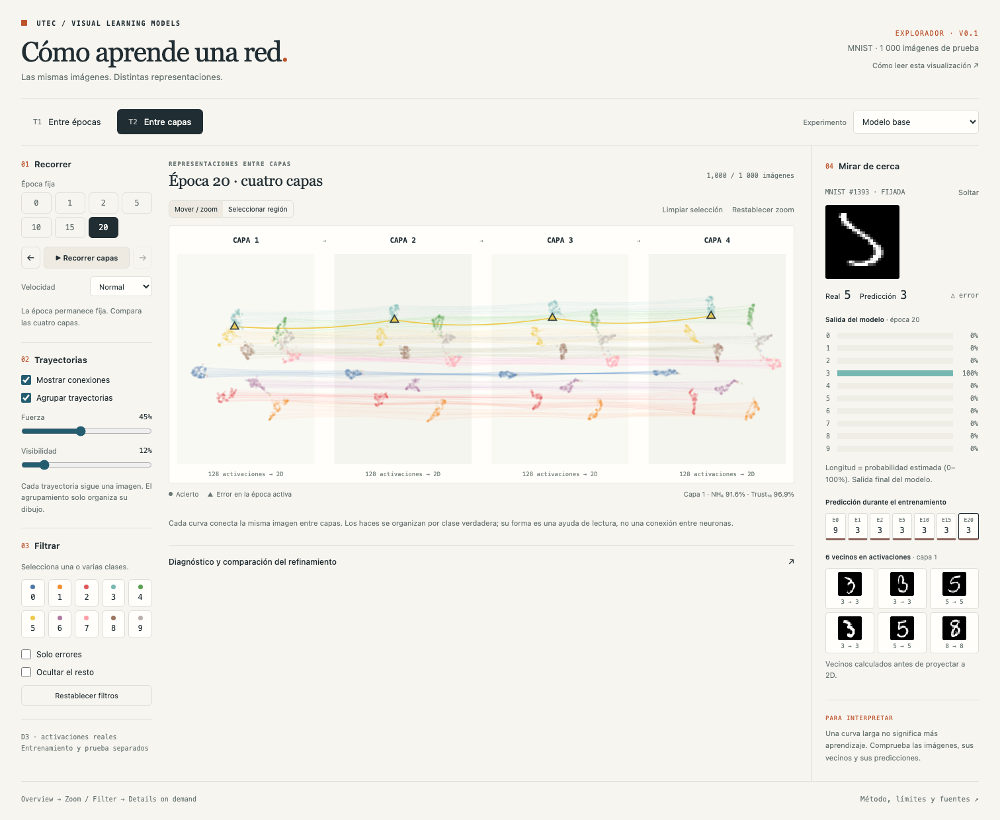

# Cómo aprende una red

Explorador de representaciones de una red neuronal para **Visual Learning Models · UTEC**. Versión **0.1**, preparada para revisar el diseño interactuando con datos reales.

**T1:** una capa fija, siete épocas y trayectorias agrupadas. **T2:** una época fija, cuatro capas enlazadas con trayectorias agrupadas. Una imagen mantiene su identidad en todo el recorrido.



## Abrir la aplicación

Python 3.10 o superior recomendado. No hace falta entrenar ni descargar MNIST para visualizar los resultados incluidos.

```bash
python3 -m venv .venv
source .venv/bin/activate
python -m pip install -r requirements.txt
python app.py
```

Abrir **http://127.0.0.1:5123/**. En macOS también se puede ejecutar `start.command`.

Para generar un archivo HTML que funciona sin conexión y sin servidor:

```bash
python scripts/export.py --output preview.html
```

El HTML contiene los mismos datos, D3, imágenes y código que la aplicación Flask.

## Un recorrido para empezar

1. En **T1**, observar el resumen completo y reproducir las épocas. Cambiar la capa fija.
2. Desactivar **Agrupar trayectorias** y comparar. Ajustar fuerza y visibilidad.
3. Seleccionar las clases **3 y 5**, ir a época **20**, activar **Solo errores** y fijar una imagen.
4. Examinar la imagen, su historial de predicciones y los vecinos originales.
5. Abrir **T2** y localizar la misma imagen en las cuatro capas.
6. Seleccionar una región y revisar sus imágenes en la galería.
7. Abrir **Diagnóstico y comparación del refinamiento**; pulsar una celda para recuperar sus ejemplos.

La interacción sigue el mantra: **overview → zoom/filter → details on demand**. La comparación estática permanece disponible junto con la animación.

## Experimento y resultados incluidos

- MNIST real: 28×28 píxeles, diez clases.
- 50 000 imágenes de entrenamiento, 10 000 de validación, 10 000 de prueba.
- Muestra visual fija: 1 000 imágenes de prueba, 100 por clase.
- MLP `784 → 128 → 128 → 128 → 128 → 10`, ReLU; Adam, tasa 0.001, lotes de 128.
- Semilla 42; checkpoints reales en épocas 0, 1, 2, 5, 10, 15 y 20.
- Refinamiento: dilatación 3×3 en un 25% fijo de imágenes de entrenamiento. Validación y prueba permanecen originales. Misma inicialización, partición y orden de lotes.

| Resultado final | Base | Dilatación |
|---|---:|---:|
| Exactitud, prueba completa (n=10 000) | 97.80% | 97.30% |
| Exactitud, muestra visual (n=1 000) | 97.20% | 96.60% |
| Errores, muestra visual | 28 | 34 |

La intervención **no mejoró** la exactitud final en este ensayo. En la muestra, corrigió 12 imágenes antes erróneas y volvió erróneas 18 antes correctas. Un único ensayo no permite inferir significancia ni superioridad general de un método.

## Método visual

Las proyecciones se calculan con **AlignedUMAP**, enlazando los mismos identificadores, sin etiquetas de clase en el ajuste. El agrupamiento del dibujo aproxima el precedente de curvas Bézier atraídas hacia centroides de clase. Conserva todos los estados medidos; no es una reproducción de CUBu.

- Punto = imagen representada por sus activaciones.
- Matiz = clase verdadera, asignación fija Tableau10.
- Círculo/triángulo = acierto/error de la salida final en la época activa.
- Conexión = identidad entre estados; nunca una conexión neuronal.
- Luminancia en T1 = avance de época; posición de panel en T2 = orden de capa.
- Tamaño constante; selección mediante contorno y foco/contexto.

El agrupamiento usa etiquetas para ordenar líneas. **La existencia de haces no demuestra aprendizaje.** La proyección y el dibujo tienen limitaciones diferentes. Una curva larga no significa que el modelo aprendió más, y los estados intermedios de la animación no son checkpoints medidos.

## Reproducir los cálculos

Se recomienda un entorno separado para las dependencias de entrenamiento:

```bash
python3 -m venv .venv-training
source .venv-training/bin/activate
python -m pip install -r requirements-training.txt
python scripts/train.py --cache work
python scripts/project.py --cache work
python scripts/export.py --output preview.html
```

La primera ejecución descarga MNIST. Los checkpoints y activaciones quedan en `work/`, excluido del repositorio. Las versiones exactas del cálculo están en `requirements-training.txt` y `static/data/manifest.json`; la reproducibilidad numérica entre sistemas puede variar.

Se calcula además un **t-SNE conjunto** de la última capa a través de épocas, como contraste con la sección 5.4 del paper. Sus coordenadas y métricas se incluyen en `reference-tsne` dentro de los datos; el recorrido principal usa AlignedUMAP.

## Archivos de entrega

| Ruta | Contenido |
|---|---|
| `app.py`, `templates/`, `static/` | Aplicación Flask y D3 local |
| `static/data/dataset.json` | Cohorte, predicciones, probabilidades, vecinos, proyecciones y métricas |
| `static/data/nodes.csv` | 112 000 estados de observaciones, con IDs y coordenadas |
| `static/data/edges.csv` | 90 000 conexiones entre estados consecutivos de la misma imagen |
| `static/data/digits.png` | Atlas de las 1 000 imágenes originales |
| `static/data/manifest.json` | Configuración, particiones, versiones y resultados |
| `static/data/sha256.json` | Integridad de los archivos de datos |
| `docs/design.md` | Preguntas, idioms, marcas, canales y límites |
| `docs/requirements.md` | Trazabilidad con el enunciado |
| `docs/presentation-guide.md` | Guion inicial de exposición con referencias de clase |
| `tests/` | Integridad de datos, endpoints y recorrido de navegador |

## Validación

```bash
python -m pip install pytest
python -m pytest tests/test_integrity.py -q
```

Con el servidor en ejecución, las interacciones pueden comprobarse con Playwright:

```bash
npm install
npx playwright install chromium
npm test
```

La validación cubre identidades entre estados, particiones, probabilidades, integridad CSV/JSON, API, filtros, selección, detalle, agrupamiento, zoom, reproducción, matrices, cambio de experimento y adaptación móvil. Ver [validación de esta versión](docs/validation.md).

## Fuentes y atribución

- Rauber, P. E.; Fadel, S. G.; Falcão, A. X.; Telea, A. C. (2017). [Visualizing the Hidden Activity of Artificial Neural Networks](https://webspace.science.uu.nl/~telea001/VisualAnalytics/NNHidden), especialmente sección 5.4.
- Paolo Vásquez: [VisLearnModels](https://github.com/paolovasquezg/VisLearnModels). Precedente de paneles de capas conectados y curvas hacia centroides.
- Ricardo Amiel: [A-simple-Visual-Learning-Model-for-MNIST](https://github.com/ricardoamiel/A-simple-Visual-Learning-Model-for-MNIST). Precedente de miniaturas, filtros e inspector.
- [AlignedUMAP](https://umap-learn.readthedocs.io/en/latest/aligned_umap_basic_usage.html); [D3](https://d3js.org/); [MNIST mediante torchvision](https://docs.pytorch.org/vision/stable/generated/torchvision.datasets.MNIST.html).
- Wattenberg, Viégas y Johnson: [How to Use t-SNE Effectively](https://distill.pub/2016/misread-tsne/).

Se implementó código propio y se entrenaron modelos propios; no se adoptan como resultados propios las métricas de los precedentes. Los PDF proporcionados y la grabación de clase permanecen como referencias locales y no se redistribuyen en este repositorio.

Licencia MIT para el código propio. D3 conserva su licencia en `static/vendor/D3-LICENSE`. Los datos y las publicaciones conservan sus condiciones originales.
