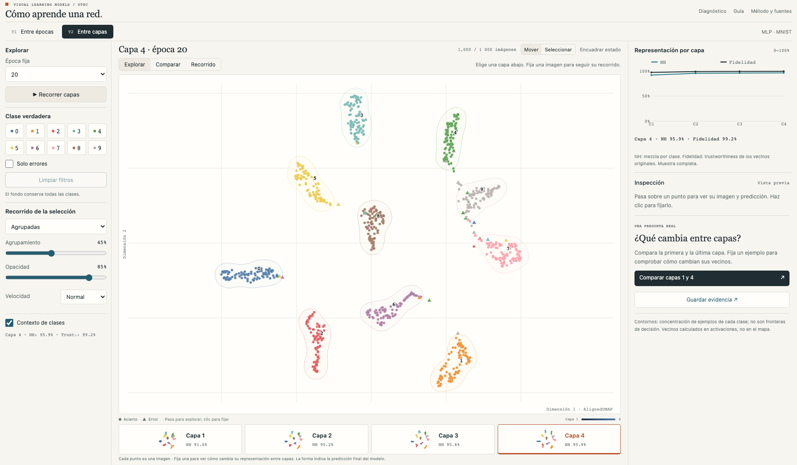

# Cómo aprende una red

Explorador de representaciones de una red neuronal para **Visual Learning Models · UTEC**. Versión **0.7.2**, preparada para revisar el diseño interactuando con datos reales.

**T1:** una capa fija y trayectorias agrupadas desde la inicialización. **T2:** una época fija, un mapa grande con cuatro miniaturas de capa, comparación estática de dos capas y recorrido agrupado en un espacio compartido. Una imagen mantiene su identidad en todo el recorrido.



## Abrir la aplicación

Python 3.10 o superior recomendado. No hace falta entrenar ni descargar MNIST para visualizar los resultados incluidos.

```bash
python3 -m venv .venv
source .venv/bin/activate
python -m pip install -r requirements.txt
python app.py
```

Abrir **http://127.0.0.1:5123/**. En macOS también se puede ejecutar `start.command`.

Para generar un archivo HTML que funciona sin conexión y sin servidor:

```bash
python scripts/export.py --output preview.html
```

El HTML contiene los mismos datos, D3, imágenes y código que la aplicación Flask.

La [guía de exposición](docs/presentation-guide.md) vincula cada hallazgo con acciones concretas y los cuatro criterios de la rúbrica. En la época 20, los casos 1182 y 1393 se pueden abrir desde las celdas 6 → 8 y 5 → 3 de la matriz de confusión.

## Un recorrido para empezar

1. Observa la **Inicialización** en T1. Las miniaturas y la reproducción pasan por las épocas 1, 5, 10, 15 y 20. La medición de la época 2 forma parte de las trayectorias.
2. Haz **⌘ + clic** en dos miniaturas para elegir A y B en ese orden. En la barra superior, **Investigar 15 → 20** abre ese par directamente. El comparador separa imágenes que pasan a acertar, empiezan a fallar, siguen erradas y siguen correctas.
3. Elige **Empiezan a fallar (8)**. Revisa sus imágenes y fija un ejemplo: el círculo vacío es A y el símbolo lleno B. Ambos extremos son posiciones medidas de la misma secuencia; en este modo se reemplaza el recorrido acumulado por la comparación directa.
4. Comprueba su predicción y cuántos de los seis vecinos originales conserva. Los vecinos nuevos tienen una marca inferior; **Conectar vecinos en el mapa** permite localizar las relaciones calculadas en activaciones.
5. Pulsa **Guardar evidencia** para descargar un HTML autónomo con mapa, imagen fijada, predicciones, selección, IDs y límites de interpretación.
6. Desactiva el comparador y pasa a **T2**. Elige una capa con las cuatro miniaturas. **Explorar** muestra un mapa amplio y el recorrido de las imágenes seleccionadas; **Comparar** muestra A y B sin cables entre paneles y comparte la selección; **Recorrido** reúne las trayectorias hasta la capa activa. El inspector compara los vecinos originales de las capas elegidas. La curva muestra NH y fidelidad por capa.
7. Selecciona una celda de la **matriz de confusión** para ver sus imágenes en el mapa y la galería. En Inicialización, la matriz compara la clase real con un dígito sorteado por imagen mediante un sorteo uniforme con semilla fija. Desde la época 1, compara la clase real con la predicción medida del modelo.

El mantra se mantiene: **overview → zoom/filter → details on demand**. Hover actualiza detalles sin atenuar el mapa; clic fija una imagen. Controles e inspector ocupan columnas más anchas, con áreas de pulsación y textos legibles. La curva queda fijada arriba del panel derecho, con valores activos y consulta por hover; los detalles se desplazan por separado. Las herramientas no desplazan la proyección y los filtros conservan contexto tenue. El encuadre usa los límites de toda la secuencia con escala isotrópica y constante entre épocas. «Encuadrar estado» permite acercar explícitamente lo mostrado.

Los contornos de clases usan densidad estimada, con parámetros fijos entre estados. No son fronteras del clasificador ni prueban la existencia de grupos separados. Pueden tener varias islas; los ejemplos aislados siguen presentes. Al comparar, «Acercar al filtro» incluye posiciones A y B. La curva temporal usa exactitud y NH sobre las mismas 1 000 imágenes, con épocas espaciadas uniformemente como checkpoints, aunque sus intervalos de entrenamiento son desiguales.

### Un hallazgo que se puede comprobar

De época 15 a 20, en la muestra fija, **6 imágenes pasan de error a acierto, 8 empiezan a fallar, 20 siguen erradas y 966 siguen correctas**. Los errores pasan de 26 a 28. Esto describe esa cohorte: no significa que todo entrenamiento adicional perjudique al modelo. La comparación de predicciones es medida; su relación con una trayectoria o cambio de vecinos es exploratoria y no una explicación causal.

## Experimento y resultados incluidos

- MNIST real: 28×28 píxeles, diez clases.
- 50 000 imágenes de entrenamiento, 10 000 de validación, 10 000 de prueba.
- Muestra visual fija: 1 000 imágenes de prueba, 100 por clase.
- MLP `784 → 128 → 128 → 128 → 128 → 10`, ReLU; Adam, tasa 0.001, lotes de 128.
- Semilla 42; checkpoints reales en épocas 0, 1, 2, 5, 10, 15 y 20.
- Un único modelo entrenado con imágenes originales, con validación y prueba separadas.

| Resultado final | Modelo MLP |
|---|---:|
| Exactitud, prueba completa (n=10 000) | 97.80% |
| Exactitud, muestra visual (n=1 000) | 97.20% |
| Errores, muestra visual | 28 |

## Método visual

Las proyecciones se calculan con **AlignedUMAP**, enlazando los mismos identificadores, sin etiquetas de clase en el ajuste. El agrupamiento del dibujo aproxima el precedente de curvas Bézier atraídas hacia centroides de clase. Conserva todos los estados medidos; no es una reproducción de CUBu.

- Punto = imagen representada por sus activaciones.
- Matiz = clase verdadera, asignación fija Tableau10.
- Círculo/triángulo = acierto/error de la salida final en la época activa.
- Conexión = identidad entre estados; nunca una conexión neuronal.
- Luminancia = avance de época en T1 y profundidad de capa en T2; miniaturas y números identifican las capas.
- Tamaño de marca para legibilidad: contexto reducido, errores ampliados ligeramente y selección fijada con énfasis; hover añade contorno.

El agrupamiento usa etiquetas para ordenar líneas. **La existencia de haces no demuestra aprendizaje.** La proyección y el dibujo tienen limitaciones diferentes. Una curva larga no significa que el modelo aprendió más, y los estados intermedios de la animación no son checkpoints medidos.

**Agrupamiento al 0%** dibuja conexiones rectas y **Opacidad al 0%** oculta las conexiones.

La época 0 es la red inicial sin entrenamiento. Su conexión con época 1 es una referencia útil para estudiar el inicio del aprendizaje; no debe interpretarse como una trayectoria continua observada durante esa época. Se conserva la referencia y se ofrece atenuación para facilitar el diagnóstico posterior. Ver [auditoría y corrección de curvas](docs/trajectory-audit.md).

## Reproducir los cálculos

Se recomienda un entorno separado para las dependencias de entrenamiento:

```bash
python3 -m venv .venv-training
source .venv-training/bin/activate
python -m pip install -r requirements-training.txt
python scripts/train.py --cache work
python scripts/project.py --cache work
python scripts/export.py --output preview.html
```

La primera ejecución descarga MNIST. Los checkpoints y activaciones quedan en `work/`, excluido del repositorio. Las versiones exactas del cálculo están en `requirements-training.txt` y `static/data/manifest.json`; la reproducibilidad numérica entre sistemas puede variar.

Se calcula además un **t-SNE conjunto** de la última capa a través de épocas, como contraste con la sección 5.4 del paper. Sus coordenadas y métricas se incluyen en `reference-tsne` dentro de los datos; el recorrido principal usa AlignedUMAP.

## Archivos de entrega

| Ruta | Contenido |
|---|---|
| `app.py`, `templates/`, `static/` | Aplicación Flask y D3 local |
| `static/data/dataset.json` | Cohorte, predicciones, probabilidades, vecinos, proyecciones y métricas |
| `static/data/nodes.csv` | 56 000 estados de observaciones, con IDs y coordenadas |
| `static/data/edges.csv` | 45 000 conexiones entre estados consecutivos de la misma imagen |
| `static/data/digits.png` | Atlas de las 1 000 imágenes originales |
| `static/data/manifest.json` | Configuración, particiones, versiones y resultados |
| `static/data/sha256.json` | Integridad de los archivos de datos |
| `docs/design.md` | Preguntas, idioms, marcas, canales y límites |
| `docs/requirements.md` | Trazabilidad con el enunciado |
| `docs/presentation-guide.md` | Guion inicial de exposición con referencias de clase |
| `tests/` | Integridad de datos, endpoints y recorrido de navegador |

## Validación

```bash
python -m pip install pytest
python -m pytest tests/test_integrity.py -q
```

Con el servidor en ejecución, las interacciones pueden comprobarse con Playwright:

```bash
npm install
npx playwright install chromium
npm test
```

La validación incluye las 49 parejas de épocas, partición exhaustiva de transiciones, comparación de vecinos por ID y exportación de evidencia. También cubre identidades entre estados, particiones, probabilidades, integridad CSV/JSON, API, filtros, selección, detalle, agrupamiento, zoom, reproducción, matriz de confusión y adaptación móvil. Ver [validación de esta versión](docs/validation.md).

## Fuentes y atribución

- Rauber, P. E.; Fadel, S. G.; Falcão, A. X.; Telea, A. C. (2017). [Visualizing the Hidden Activity of Artificial Neural Networks](https://webspace.science.uu.nl/~telea001/VisualAnalytics/NNHidden), especialmente sección 5.4.
- [AlignedUMAP](https://umap-learn.readthedocs.io/en/latest/aligned_umap_basic_usage.html); [D3](https://d3js.org/); [MNIST mediante torchvision](https://docs.pytorch.org/vision/stable/generated/torchvision.datasets.MNIST.html).
- Wattenberg, Viégas y Johnson: [How to Use t-SNE Effectively](https://distill.pub/2016/misread-tsne/).

El código y el entrenamiento corresponden a esta implementación. Los PDF proporcionados y la grabación de clase permanecen como referencias locales y no se redistribuyen en este repositorio.

Licencia MIT para el código propio. D3 conserva su licencia en `static/vendor/D3-LICENSE`. Los datos y las publicaciones conservan sus condiciones originales.
